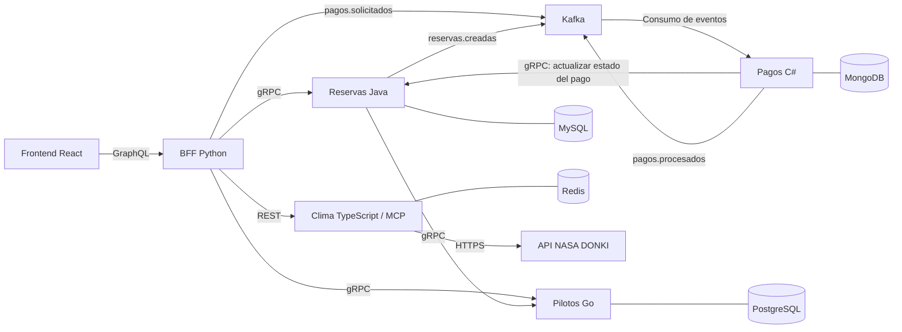

# Nébula Rent: arquitectura y pendientes del taller

## Arquitectura actual del proyecto

Nébula Rent es una plataforma de arriendo de naves espaciales. Permite registrar pilotos, consultar naves, crear reservas, evaluar el clima espacial y procesar pagos simulados.

Los ocho componentes tienen repositorios privados independientes en GitHub. El repositorio principal los enlaza como submódulos y fija la versión de cada uno.

| Componente | Responsabilidad | Tecnología | Almacenamiento |
|---|---|---|---|
| Frontend | Interfaz de pilotos, naves, reservas y pagos | React y TypeScript | Sin base de datos |
| BFF / API Gateway | Expone `/graphql` y coordina los servicios | Python, FastAPI y Strawberry | Sin base de datos |
| Pilotos | Registro y consulta de pilotos y licencias | Go | PostgreSQL |
| Reservas | Gestión de naves, reservas y estado del pago | Java y Spring Boot | MySQL |
| Pagos | Procesamiento de cobros simulados | C# y .NET | MongoDB |
| Clima MCP | Consulta de clima espacial y evaluación de rutas | TypeScript y Express | Redis como caché |
| Contratos | Contratos compartidos para gRPC | Protobuf | No aplica |
| Infraestructura | Configuración de despliegue y clúster local | Kubernetes, Kustomize y kind | Volúmenes para las bases de datos y Kafka |

### Comunicación entre componentes

El BFF consume el servicio de clima por REST. El mismo servicio también expone herramientas MCP en `/mcp` para clientes compatibles.

### Flujo de una reserva

1. El frontend envía una mutation GraphQL al BFF.
2. El BFF consulta el clima espacial para evaluar la ruta.
3. El BFF solicita la reserva por gRPC. Reservas consulta a Pilotos para validar su estado y licencia.
4. Reservas guarda la información en MySQL y publica `reservas.creadas` en Kafka.
5. Pagos consume el evento y registra un cobro pendiente en MongoDB.
6. Cuando se solicita el pago, el BFF publica `pagos.solicitados` en Kafka.
7. Pagos procesa el cobro simulado, actualiza Reservas mediante gRPC y publica `pagos.procesados`.

### Docker, Kubernetes y pruebas

Cada servicio y el frontend tienen su propio Dockerfile. La infraestructura incluye manifiestos para desplegar las aplicaciones, PostgreSQL, MySQL, MongoDB, Redis y Kafka en el namespace `nebula-rent`.

También existen pruebas y configuraciones de cobertura mínima del 60 %, junto con workflows de GitHub Actions para pruebas y publicación de imágenes. La configuración existe, pero aún falta validar la ejecución completa y registrar los resultados reales de cobertura y despliegue.

## Arquitectura solicitada por el taller

Según los apuntes de la clase y el esquema de la pizarra, la arquitectura solicitada se interpreta así:

| Requisito | Descripción |
|---|---|
| Frontend conectado a un BFF | La entrada del frontend debe pasar por un BFF / API Gateway. |
| Endpoint GraphQL | El BFF debe exponer GraphQL para consultar la información de los servicios. |
| Comunicación entre servicios | Se deben utilizar al menos dos mecanismos distintos. En la pizarra aparecen gRPC, Kafka y REST, y se mencionan alternativas como NATS y RabbitMQ. |
| Lenguajes diferentes | Cada microservicio debe estar implementado en un lenguaje distinto. |
| Bases de datos diferentes | Cada microservicio debe tener su propia base de datos, utilizando motores distintos. |
| Contenedores | Cada microservicio debe tener su propia imagen Docker. |
| Orquestación | Las imágenes deben ejecutarse en un clúster de Kubernetes. |
| Cobertura | Cada microservicio debe alcanzar al menos un 60 % de cobertura de pruebas. |
| Pipeline CI | Cada repositorio debe contar con un pipeline que ejecute las validaciones y pruebas. |
| Repositorios separados | Cada servicio debe tener su propio repositorio. |
| Temática libre | El dominio elegido para el proyecto es el arriendo de naves espaciales. |

### Puntos por confirmar con el profesor

- Si los dos mecanismos de comunicación se exigen para el sistema completo o para cada microservicio.
- Si el BFF puede implementarse en Python o si debe utilizar NestJS, como aparece en el ejemplo de la pizarra.
- Si el BFF puede funcionar sin base de datos, al cumplir una función de coordinación.
- Si Redis utilizado como caché es válido como base de datos del servicio de clima.
- Si se exige implementar el servidor MCP que aparece en el esquema y si su consumo por REST desde el BFF es válido.

## Cosas por hacer o cambiar

### Pendientes para acreditar los requisitos

1. **Ejecutar los pipelines.** Verificar que las pruebas, las validaciones y la construcción de imágenes terminen correctamente en cada repositorio.
2. **Obtener los reportes de cobertura.** Registrar el porcentaje real de cada servicio y comprobar que cumple el mínimo del 60 %. Revisar también las exclusiones de código aplicadas a la medición.
3. **Construir las imágenes Docker.** Comprobar que todos los Dockerfiles permiten construir y arrancar sus servicios.
4. **Desplegar y verificar Kubernetes.** Levantar el clúster, revisar el estado de aplicaciones, bases de datos y Kafka, y demostrar el flujo completo desde el frontend.

### Correcciones funcionales detectadas

- **Sincronización del estado de pago:** Pagos guarda el cobro como procesado antes de actualizar Reservas mediante gRPC. Si esa llamada falla, el cobro puede quedar aprobado en MongoDB y pendiente en MySQL. Se necesita un mecanismo que permita reintentar la notificación aunque el cobro ya esté procesado.
- **Reintentos del consumidor Kafka:** ante un error de procesamiento, el consumidor espera y continúa consumiendo, pero no reposiciona explícitamente el mensaje fallido. Se debe asegurar su reprocesamiento antes de confirmar mensajes posteriores de la misma partición, o implementar una estrategia de reintentos.

### Cambios sujetos a confirmación

- Si se exigen dos protocolos por cada servicio, ampliar la comunicación de Pilotos, que actualmente utiliza solo gRPC, y revisar el mismo criterio para Clima.
- Si NestJS es obligatorio para el BFF, reemplazar su implementación actual en Python.
- Si todos los componentes deben tener persistencia propia, definir el alcance de esa exigencia para el BFF y para Redis en Clima.

## Estado actual

La estructura del código contempla BFF con GraphQL, servicios en lenguajes distintos, bases de datos separadas, comunicación por gRPC y Kafka, Dockerfiles y manifiestos Kubernetes. Queda pendiente comprobar con ejecuciones y reportes el funcionamiento integrado, los pipelines y la cobertura mínima exigida.
