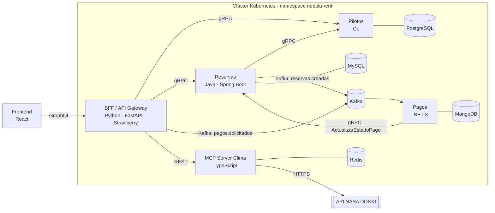

# 🚀 Nébula Rent — arriendo de naves espaciales

Plataforma ficticia de arriendo de naves que operan desde el *Puerto Espacial Atacama*.
Los pilotos reservan naves para viajar a la Luna, Marte, Europa, Titán y otros destinos. Antes de
cada reserva se consulta el **clima espacial real** (llamaradas solares de la NASA) para autorizar
o suspender la ruta.

## Arquitectura



| Repo | Rol | Lenguaje | Base de datos | Protocolos |
|---|---|---|---|---|
| [`nebula-frontend`](nebula-frontend) | UI | React + TS | — | GraphQL |
| [`nebula-bff`](nebula-bff) | BFF / API Gateway | **Python** | — | GraphQL ⇄ gRPC, Kafka, REST |
| [`nebula-pilotos`](nebula-pilotos) | Pilotos | **Go** | PostgreSQL | gRPC |
| [`nebula-reservas`](nebula-reservas) | Naves y reservas | **Java** | MySQL | gRPC + Kafka (productor) |
| [`nebula-pagos`](nebula-pagos) | Cobros | **C# / .NET** | MongoDB | Kafka (consumidor) + gRPC |
| [`nebula-clima-mcp`](nebula-clima-mcp) | MCP Server de clima | **TypeScript** | Redis | REST + MCP |
| [`nebula-infra`](nebula-infra) | Orquestación | YAML | — | Kubernetes |
| [`nebula-contracts`](nebula-contracts) | Contratos `.proto` y eventos | Protobuf | — | — |

### Requisitos cubiertos
- **BFF con endpoint GraphQL**: `nebula-bff` expone `/graphql` (queries y mutations).
- **Al menos dos formas de comunicación entre microservicios**: **gRPC** (síncrona) y **Kafka**
  (asíncrona), además de REST hacia el MCP Server.
- **Cada microservicio en un lenguaje distinto y con su propia base de datos**: Python, Go, Java,
  .NET y TypeScript; PostgreSQL, MySQL, MongoDB y Redis.
- **Un Dockerfile por servicio** (multi-stage, usuario sin root) y **todas las imágenes orquestadas en
  Kubernetes** (`nebula-infra`).
- **Pipeline CI con cobertura mínima del 60 %** en cada repo (GitHub Actions), que además publica la
  imagen en GHCR:

  | Repo | Herramienta de cobertura | Corte |
  |---|---|---|
  | nebula-bff | pytest-cov `--cov-fail-under=60` | 60 % |
  | nebula-pilotos | `go test -coverprofile` + `scripts/check-coverage.sh` | 60 % |
  | nebula-reservas | JaCoCo `check` (LINE ≥ 0.60) | 60 % |
  | nebula-pagos | coverlet `Threshold=60` | 60 % |
  | nebula-clima-mcp | vitest v8 `thresholds` | 60 % |
  | nebula-frontend | vitest v8 `thresholds` | 60 % |

- **Cada servicio en su propio repositorio**: cada carpeta es un repo git independiente.
  `publicar-repos.sh` los crea y sube a GitHub.

## Flujo de una reserva con pago

1. **Front → BFF** `mutation crearReserva`
2. **BFF → MCP Server (REST)**: evalúa la ruta con las llamaradas solares de NASA. Si el riesgo es
   `EXTREMO`, se rechaza.
3. **BFF → Reservas (gRPC)** `CrearReserva` → **Reservas → Pilotos (gRPC)** valida licencia y estado.
4. Reservas guarda en MySQL y publica **`reservas.creadas`** en Kafka → Pagos crea un cobro `PENDIENTE`.
5. **Front → BFF** `mutation pagarReserva` → BFF publica **`pagos.solicitados`** en Kafka.
6. **Pagos** cobra en la pasarela simulada, guarda en MongoDB, llama a **Reservas (gRPC)**
   `ActualizarEstadoPago` y publica `pagos.procesados`.
7. El front ve el estado `APROBADO` o `RECHAZADO` en la reserva, que se actualiza cada 5 s.

## Levantar todo
```bash
cd nebula-infra && ./deploy-local.sh     # kind + build de las 6 imágenes + kubectl apply -k
```
Detalles en [`nebula-infra/README.md`](nebula-infra/README.md).

## Publicar los repos en GitHub
```bash
./publicar-repos.sh <tu-usuario-u-organizacion>    # requiere gh autenticado
```
